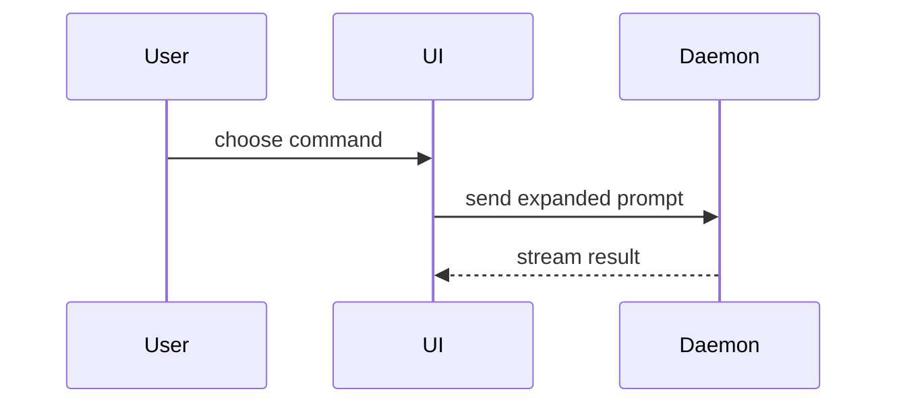

Forked from humanlayer/skills `plugins/show-me` (v1.0.1, 2026-09-12). Arguments: `$ARGUMENTS`.
With `review` or `rinse`, also follow [review.md](review.md), which builds a review page out of
the views below.

Help the user understand the current topic of conversation visually. Skip the preamble and keep prose brief. Pick the smallest view that makes the key point clear.

- Show logic or an algorithm as pseudocode:

```text
on(save)
  if content is unchanged
    return cached result
  write new content
  return fresh result
```

- Show runtime control flow as a call tree:

```text
submitForm
  createSession
    persistPrompt
    launchAgent
  navigateToSession
```

- Show UI structure as a component tree, including state and module boundaries that matter:

```tsx
<SessionPage> (apps/example/src/routes/session.tsx)
  useSessionEvents()
  <SessionToolbar>
    <RunSkillButton> (packages/ui)
```

- Show file responsibility or a broad refactor as a shallow file tree:

```text
src/
├── commands/       # parses user actions
├── sessions/       # owns session state
└── transport/      # sends API requests
```

- Show component interaction, control flow, or data flow with Mermaid:



- Use `diff` when the point is what changes and the surrounding shape already exists. Match the diff shape to the topic.

For a component change:

```diff
 <SessionPage>
   useSessionEvents()
   <SessionToolbar>
+    <RunSkillButton />
   <SessionTimeline>
+    <SkillResultCard />
```

For a file-layout change:

```diff
 src/
 ├── commands/
+│   └── show-me.ts       # expands the slash command
 ├── sessions/
-└── transport.ts
+└── transport/
+    ├── client.ts
+    └── stream.ts
```

For a call-tree or call-stack change:

```diff
 submitForm
   createSession
     persistPrompt
+    expandSkillMention
     launchAgent
-  navigateToSession
+  navigateToSession
+    subscribeToEvents
```

For a state or control-flow change:

```diff
 on(save)
-  write content
+  if content is unchanged
+    return cached result
+  write new content
+  invalidate cache
```

- Show the whole block when most of it is new, when omitted context would hide ownership or order, or when the user needs a copyable target shape:

```ts
function expandSkill(command: string): string {
  const skillName = command.slice(1)
  return `use the ${skillName} skill`
}
```

- For a visual UI, layout, state comparison, or concept too dense for Mermaid, write one focused HTML page (a diagram, an infographic, or a short slide deck, whichever fits the point) and publish it as a private Artifact: load the `artifact-design` skill first, write the file to the session's scratch dir (august: `$AUGIE_SCRATCH`, else `scratch/<topic>/`; elsewhere the scratchpad), publish it, and give the link. Match the product's colors, type, spacing, and components; use real labels and data. Mermaid renders natively in artifacts (`<pre class="mermaid">`).

- For a bug, race, or anything where order matters, a numbered sequence with the state at each step beats prose: what the server has, what the device has, which version of the row. A before/after pair of the same scenario (two mermaid sequences, or two columns) shows the fix.

- For boundary logic, a worked-example table: input | old result | new result | right answer.

### guidance

Place each visual next to the short text it supports. Keep only the calls, files, props, states, and boundaries needed to answer the user's current question or the options to resolve the current discussion point.

Name things with the domain's words, never terms coined in this session ("pass list", "v1/v2"). When two terms are easy to confuse, define them in one line each before using them. Draw only symbols that exist in the code. Skip a diagram when a pseudocode diff says it; a one-line guard never needs one.

Never put customer or production data in an artifact: dev and test data only.

You may use one of these, you may use several, it is unlikely you will use all of them. Use your judgement and don't overwhelm the user.
